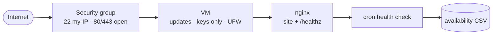

# Cloud Infrastructure Deployment & Monitoring Lab

**Personal Project / Technical Lab** — by Jeff Mutisya. Not client work.

A minimal, auditable single-host baseline: key-only SSH, three open
ports, an nginx health endpoint, and a weekly log routine — rehearsed on
a local VM before spending anything on cloud. Optional Terraform
skeleton for the instance + security group.

## 1. Project overview

Small teams often run one web host with no documented baseline. This lab
defines the smallest host worth running and writes it down: hardening
checklist, health-check script, Terraform skeleton, cost notes.

## 2. Problem statement

A single unmanaged host drifts: password SSH left on, firewall rules
accumulate, nobody checks logs. The fix is not more tooling — it is a
written baseline plus a 10-minute weekly routine.

## 3. Objectives

- Harden one Linux host (keys, firewall, updates) from a checklist
- Serve HTTP + a `/healthz` endpoint via nginx
- Log availability with a cron health check
- Keep cost at the cheapest instance class, with local-first rehearsal
- Document security and cost decisions explicitly

## 4. Architecture



```text
Internet → SG(22/80/443) → VM → nginx → /healthz → cron → CSV log → weekly review
```

## 5. Technology stack

Ubuntu/Debian Linux, OpenSSH, UFW (or cloud security groups), nginx,
bash + cron. Optional: Terraform (~> 1.5) for the instance + SG.

## 6. Repository structure

```text
docs/checklist.md        # full step-by-step runbook
scripts/health-check.sh  # cron probe: HTTP status + ms → CSV
scripts/setup-ufw.sh     # firewall baseline (review before running)
terraform/main.tf        # optional: instance + security group skeleton
terraform/variables.tf
terraform/outputs.tf
```

## 7. Setup instructions

Local-first (free):

```bash
# 1. Create a local Ubuntu VM (VirtualBox/UTM/Hyper-V), then:
git clone https://github.com/Jeff-Mutisya/cloud-infrastructure-lab
cd cloud-infrastructure-lab
# 2. Follow docs/checklist.md top to bottom.
# 3. Only then reproduce on cloud with the same checklist
#    (Terraform skeleton optional: cd terraform && terraform init && terraform plan).
```

## 8. How it works

1. Updates → key-only SSH → UFW allow 22/80/443, deny rest.
2. nginx serves the site and a plain-text `/healthz` (`OK`).
3. `health-check.sh` curls `/healthz` every 5 min via cron, appending
   `timestamp,status,ms` to `/var/log/availability.csv`.
4. Weekly: review failed SSH logins + availability gaps.

## 9. Screenshots

Add yours when you run it: `ufw status numbered`, `curl /healthz`,
one week of the CSV. The checklist marks each capture point with
`[capture]`. No stock or borrowed screenshots are included.

## 10. Testing

- `curl -s -o /dev/null -w "%{http_code}" localhost/healthz` → `200`
- `sudo ufw status numbered` shows exactly 3 allow rules
- Stop nginx → next cron row shows non-200 (proves the probe is live)
- `terraform validate` + `terraform plan` (no apply needed to verify)

## 11. Security considerations

- SSH keys only (`PasswordAuthentication no`); no passwords in repo or docs.
- 22 restricted to admin IP; 80/443 public only.
- Unattended security updates enabled; fail2ban optional extra.
- Never commit `.tfvars`, `.pem`, or state files (see `.gitignore`).

## 12. Limitations

- Single host: no HA, no backups beyond provider snapshots (documented, not configured).
- HTTP only in the lab; production needs TLS (notes in checklist).
- Terraform skeleton is illustrative — adapt AMI/region to your account.

## 13. Future improvements

- TLS via Let's Encrypt + redirect
- Snapshot/backup schedule with restore test
- Uptime alerting (email/webhook) when cron detects downtime
- Ansible version of the checklist for repeat builds

## 14. Lessons learned

- Local-first rehearsal is a budget strategy: every mistake made in the
  free VM is money not spent in the cloud.
- The firewall rule list *is* the security documentation — an open port
  nobody can justify gets closed.
- A `/healthz` endpoint plus cron timestamps covers ~80% of monitoring
  for a host this size; add tooling only when the log says you need it.
